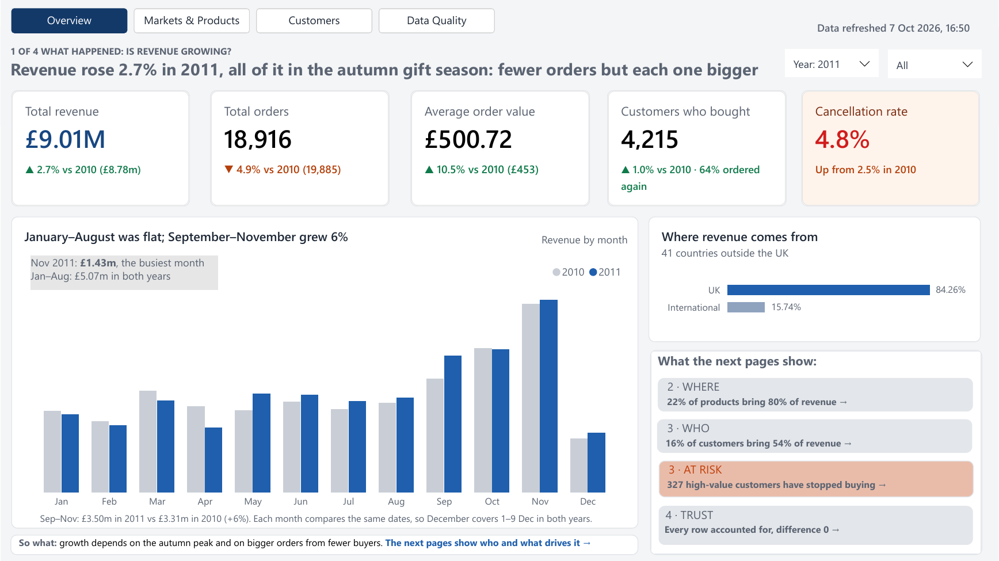
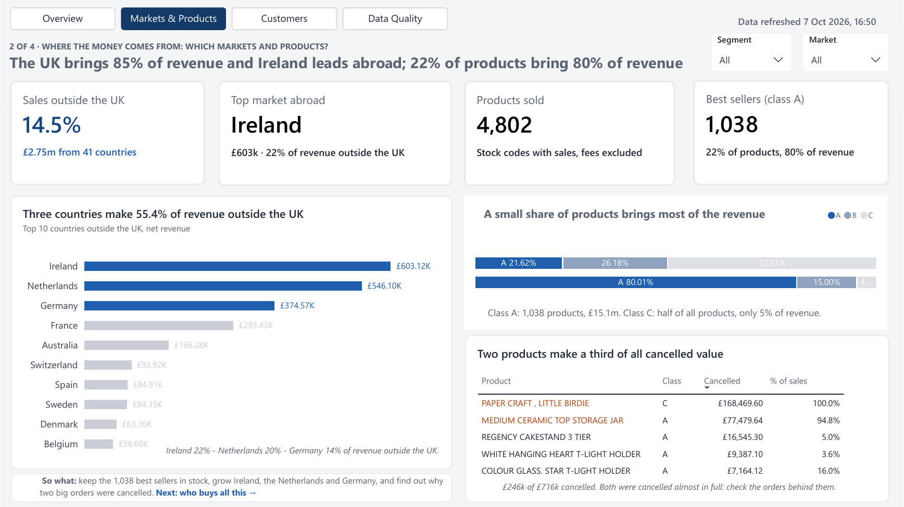
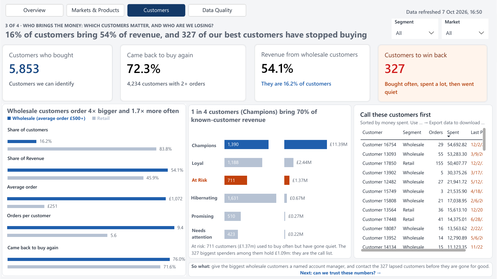
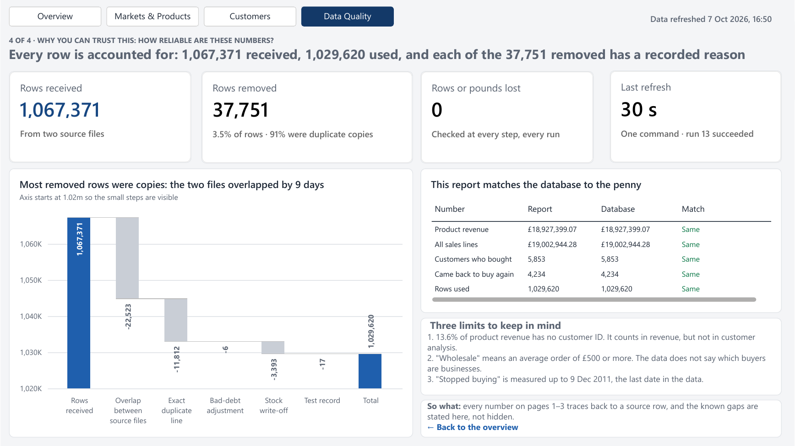

# Online Retail BI: from 1 million raw rows to a Power BI report you can trust

An end-to-end BI project on 1.07 million real transactions from a UK online retailer (Dec 2009 – Dec 2011):
raw Excel files → SQL Server (staging, cleaning, star schema, one-command pipeline) → a 4-page Power BI report that answers five business questions and reconciles to the database to the penny.

**▶ [Watch the 90-second demo](https://lucasle68-git.github.io/online-retail-bi/)** · [Report as PDF](powerbi/online_retail_bi.pdf) · [Power BI file (.pbix)](powerbi/online_retail_bi.pbix) · [All DAX measures](powerbi/tmdl/all_measures.tmdl)



## Business questions

| # | Question | Asked by | Answered on |
|---|---|---|---|
| 1 | Is net revenue growing, compared with the same period last year? | Managing director | Overview |
| 2 | Which markets outside the UK deserve more investment? | Head of international sales | Markets & Products |
| 3 | Which products drive revenue, and which are cancelled most? | Merchandising | Markets & Products |
| 4 | Do customers come back? Which segments are most valuable, and which are at risk? | Marketing / CRM | Customers |
| 5 | How far can these numbers be trusted? | Every report user | Data Quality |

## What the report found

**1. Overview: revenue rose 2.7% in 2011, all of it in the autumn gift season.**
Product revenue grew from £8.78m to £9.01m (same dates in both years). January–August was flat at £5.07m; September–November grew 6%. Orders fell 4.9% while the average order rose 10.5%: fewer orders, each one bigger. Cancellations almost doubled, from 2.5% to 4.8% of sales.

**2. Markets & Products: the UK brings 85% of revenue; 22% of products bring 80%.**
Ireland, the Netherlands and Germany make 55.4% of revenue outside the UK. 1,038 products (class A) make 80% of product revenue, while half the catalogue makes 5%. Two products, cancelled almost in full, account for £246k of the £716k cancelled.



**3. Customers: 16% of customers bring 54% of revenue, and 327 of the best have stopped buying.**
Customers whose average order is £500 or more ("wholesale") are 16.2% of customers but 54.1% of revenue; they order 4× bigger and 1.7× more often. 72.3% of customers bought more than once. 711 customers (£1.37m) used to buy often but have gone quiet; the 327 biggest spenders among them hold £1.09m and form a ready-made call list.



**4. Data Quality: every row is accounted for.**
1,067,371 rows received, 1,029,620 used, and each of the 37,751 removed has a logged reason (91% were duplicate copies from two overlapping source files). Five headline numbers in the report match the database exactly, and one command rebuilds everything in about 30 seconds.



## How it was built

```
UCI Excel (2 sheets)
  → Extract       python/convert_to_csv.py        raw CSV, every value kept as text
  → Staging       sql/01_staging_load.sql         stg schema, lineage columns
  → Clean + DQ    sql/02-05                       profiling, typed data, dq.issue_log, reconciliation
  → Star schema   sql/06-08                       dw.fact_sales + date, customer, product, country
  → Pipeline      sql/09-11                       etl.usp_run_all: one command, tests, etl.run_log
  → Views         sql/12-14                       rpt schema: segments, RFM, ABC classes, win-back list
  → Power BI      powerbi/                        import model, 89 DAX measures, 4 report pages
```

Design decisions worth a look:

- **No row disappears without a reason.** Every cleaning decision is a numbered rule (R0–R10), every excluded row is logged in `dq.issue_log` with its rule, and the pipeline stops with an error if rows or pounds go missing between layers. See [`docs/data_quality.md`](docs/data_quality.md).
- **Missing customer IDs are kept, not deleted.** They carry 13.6% of product revenue; dropping them, as many public analyses do, would understate revenue. They sit under an Unknown customer and are excluded only from customer analysis.
- **Fair year-on-year comparisons.** The data ends on 9 Dec 2011, so 2011 is compared with the same dates in 2010, not the full year.
- **One definition per metric.** Revenue, cancellation rate, segments, RFM and ABC classes are defined once in [`docs/metric_definitions.md`](docs/metric_definitions.md) and built in SQL views, so Power BI and SQL give the same answer ([`docs/reconciliation.md`](docs/reconciliation.md)).
- **DAX in source control.** All 89 measures live in one documented TMDL file, grouped by report page ([`powerbi/README.md`](powerbi/README.md)).

## Repository structure

| Folder | Contents |
|---|---|
| `python/` | Extract script |
| `sql/` | T-SQL scripts, numbered in run order, each followed by a check script |
| `powerbi/` | Report (.pbix and PDF), DAX measures (TMDL), theme |
| `docs/` | Data quality rules, metric definitions, star schema, reconciliation, findings, screenshots |
| `data/` | How to obtain the raw data (the data itself is not committed) |

## How to reproduce

1. Download the data (see [`data/README.md`](data/README.md)) to `C:\data\`.
2. `py C:\data\convert_to_csv.py` → two CSV files (525,461 and 541,910 rows).
3. In SSMS: `CREATE DATABASE RetailDW;` then run the scripts in `sql/` in number order. Each `check` script (05, 08, 11, 13) must pass before moving on.
4. From then on, one command rebuilds everything: `EXEC etl.usp_run_all;`
5. Open `powerbi/online_retail_bi.pbix` and point the data source at your SQL Server, or build the model yourself from the `rpt` views and apply [`powerbi/tmdl/all_measures.tmdl`](powerbi/tmdl/all_measures.tmdl).

## Limitations

- **"Wholesale" is a proxy.** The data has no business-customer flag, so customers are grouped by average order size (£500 or more), a threshold chosen from the order-value distribution.
- **"Stopped buying" is relative to the data.** Recency is measured up to 9 Dec 2011, the last date in the data, not to today.
- **Stock write-offs are out of scope.** 3,393 rows record lost or damaged stock with no price and no customer. With product cost data, they could be valued in £ to show where shrinkage costs the business most.

## Tools

SQL Server 2025 (Developer), T-SQL, SSMS, Python (pandas), Power BI Desktop (DAX, TMDL). Runs on an Azure Windows VM.

Data: [Online Retail II](https://archive.ics.uci.edu/dataset/502/online+retail+ii), UCI Machine Learning Repository, CC BY 4.0.

---
Lucas Le · [LinkedIn](https://www.linkedin.com/in/lucasle68/) · [GitHub](https://github.com/lucasle68-git)
