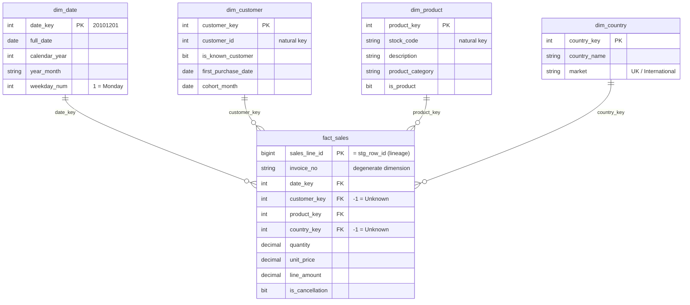

# Star schema design

Built by `sql/06_dw_objects.sql` (tables) and `sql/07_usp_load_star.sql` (load), checked by `sql/08_check_star.sql`.

## Design decisions

| # | Decision | Why |
|---|---|---|
| D1 | **Grain: one fact row per clean sales line** (1,029,620 rows) | The finest level the source offers. Orders, customers and months can all be rolled up from it; nothing can be rolled down from a summary. |
| D2 | **Surrogate keys** (`product_key`, `customer_key`, `country_key`) built with `ROW_NUMBER()` | Short integer joins, independent of source codes. Built from sorted natural keys, so a re-run gives the same keys. |
| D3 | **Unknown members with key -1** in `dim_customer` and `dim_country` | 231,751 lines (14.3% of net revenue) have no customer ID. They point to -1 instead of being dropped, so revenue stays complete and customer analysis can still filter them out. |
| D4 | **Country on the fact, not on the customer** | A few customers appear in more than one country (check S5). Country belongs to the order. |
| D5 | **One description per stock code**: the most frequent non-empty one, most recent if tied | Some codes carry several descriptions over time (check S6). A dimension needs one label per key. |
| D6 | **Non-product codes stay in `dim_product`** with `is_product = 0` | Total revenue matches the clean table to the penny; KPIs filter on `is_product = 1` (see `metric_definitions.md`). |
| D7 | **`dim_date` covers whole calendar years** (2009-2011, 1,095 days) | Power BI time intelligence (year-on-year, year-to-date) needs a continuous date table with no gaps. |
| D8 | **`invoice_no` kept on the fact** as a degenerate dimension | Groups lines into orders (average order value, order counts) without a separate order table. |
| D9 | **`cohort_month` in `dim_customer`** = month of first product purchase that was not a cancellation | Ready for retention and cohort analysis (business question 4). |

## Load safeguards

- Full refresh inside one transaction: empty the model, load dimensions, load the fact.
- Customer and country lookups fall back to -1. Product and date have no fallback: if one were missing, `NOT NULL` and the foreign keys stop the load with an error rather than dropping the row.
- Commit only if the fact has the same row count **and** the same GBP total as `clean.sales_line`; otherwise `THROW` and roll back.
